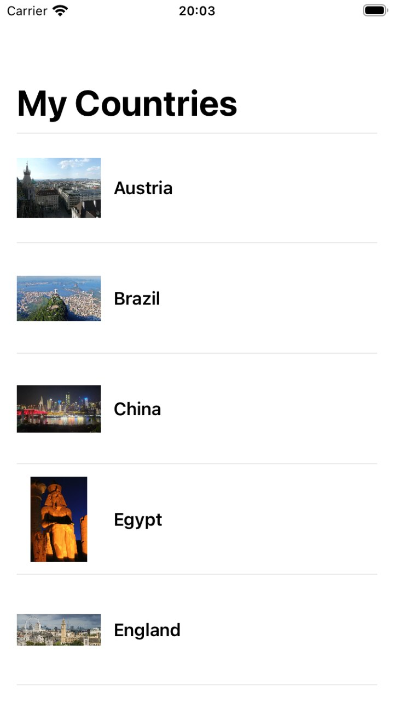
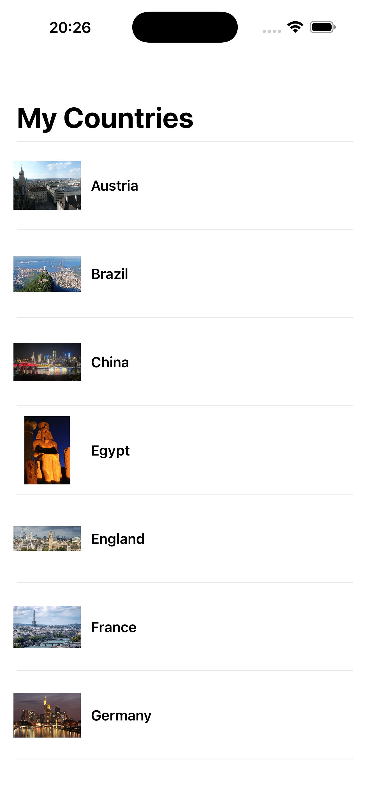
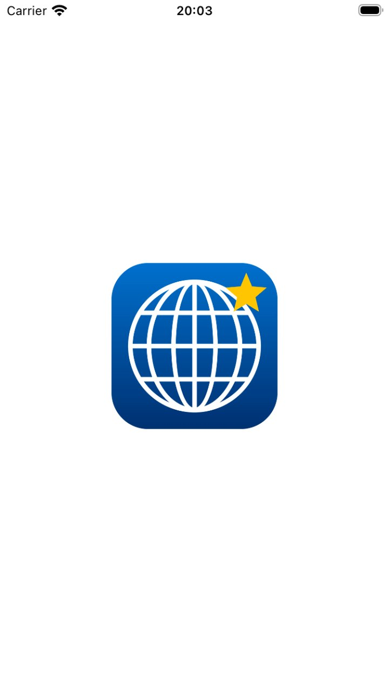
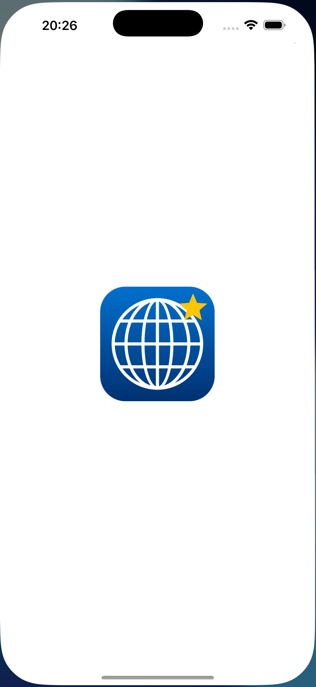
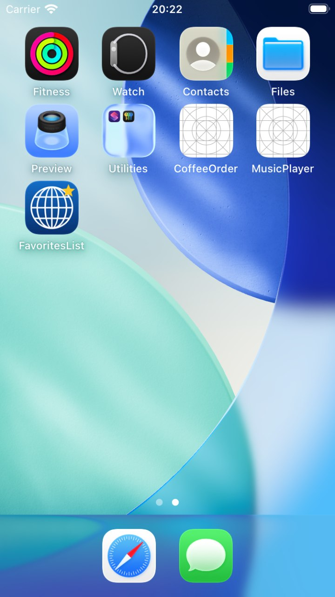
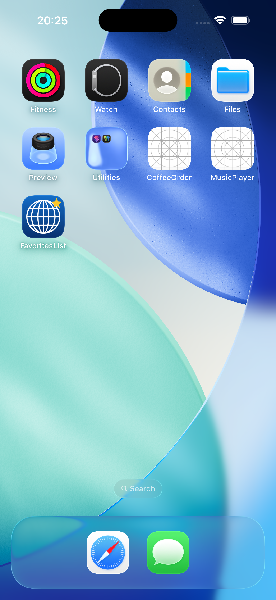

# Assignment #10 — Favorites Navigator (UINavigationController & Detail Screen)

**Author:** Iskander Bekishev
**Theme:** Countries — 20 countries I like, each with a photo of a city, a 0–5 rating and a short description.

## About the app

The app continues the Favorites List lab. The list of countries lives inside a `UINavigationController` with a large title. Each row shows only the photo and the country name. Tapping a row pushes a Detail screen that shows everything about the country: a large photo, name, continent and city, rating as SF Symbol stars and a description. The Back button and the edge swipe return to the list, and the tapped row is deselected.

Everything about screens, navigation and layout is built in `Main.storyboard`. Swift contains only the data model, the table view data source, `prepare(for:sender:)` and filling outlets from data.

## Project structure

| File | Purpose |
|---|---|
| `FavoriteItem.swift` | `struct FavoriteItem`: title, subtitle, image name, rating, description |
| `FavoriteItem+Data.swift` | `FavoriteItem.all`, the single array of 20 items |
| `FavoriteCell.swift` | Custom cell: image and title outlets only |
| `ViewController.swift` | List screen: data source, `prepare(for:sender:)` with the `showDetail` segue, deselection on return |
| `DetailViewController.swift` | Detail screen: `var item: FavoriteItem?`, fills its own outlets in `viewDidLoad` |
| `Main.storyboard` | Navigation controller, list, detail screen, Show segue `showDetail`, all Auto Layout |
| `LaunchScreen.storyboard` | Centered logo on the system background color |

## Screenshots

| Screen | iPhone SE (3rd gen) | iPhone 16 Pro Max |
|---|---|---|
| List |  |  |
| Detail |  |  |
| Launch Screen |  |  |
| App Icon |  |  |

## How to run

Open `FavoritesList.xcodeproj` in Xcode and run on any iPhone simulator. No extra setup is needed.
