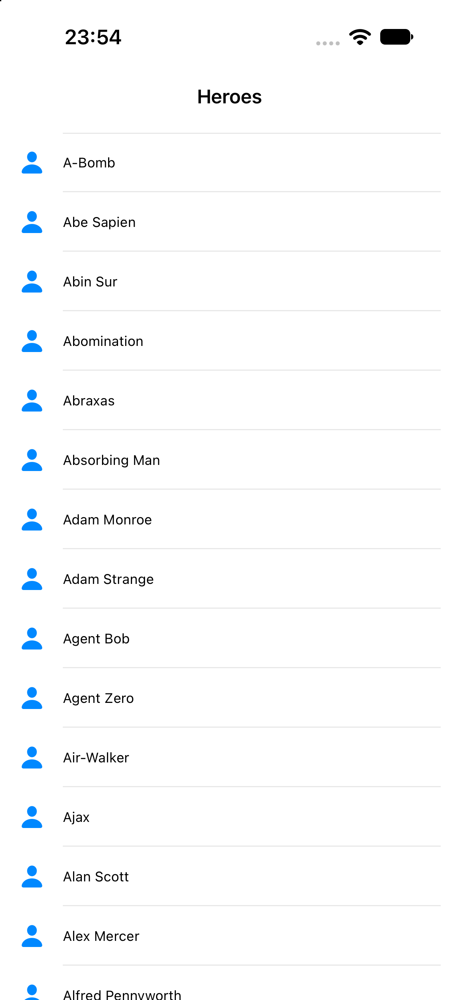
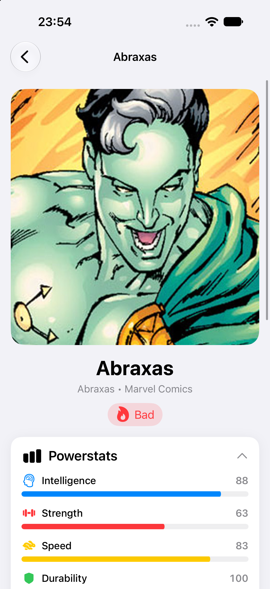
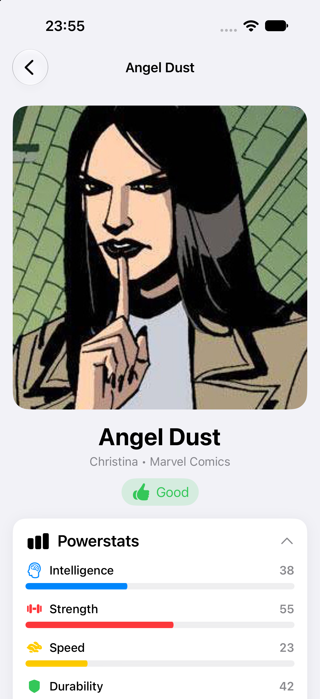

# Superheroes

**Author:** Iskander Bekishev

A UIKit app (Storyboard) that loads 563 heroes from the
[Superhero API](https://github.com/akabab/superhero-api) with URLSession + Codable,
shows them in a table view and opens a designed detail page on tap.

## Properties on the detail page

| # | Property | Group | Presentation |
|---|----------|-------|--------------|
| 1 | Intelligence | powerstats | Coloured progress bar, animates on open |
| 2 | Strength | powerstats | Coloured progress bar, animates on open |
| 3 | Speed | powerstats | Coloured progress bar, animates on open |
| 4 | Durability | powerstats | Coloured progress bar, animates on open |
| 5 | Power | powerstats | Coloured progress bar, animates on open |
| 6 | Combat | powerstats | Coloured progress bar, animates on open |
| 7 | Gender | appearance | Chip with icon in a 2-column grid |
| 8 | Race | appearance | Chip with icon |
| 9 | Height (cm) | appearance | Chip with icon |
| 10 | Weight (kg) | appearance | Chip with icon |
| 11 | Eye colour | appearance | Chip with icon |
| 12 | Hair colour | appearance | Chip with icon |
| 13 | Full name | biography | Subtitle under the name + Biography card |
| 14 | Publisher | biography | Subtitle under the name + Biography card |
| 15 | Alignment | biography | Coloured capsule badge (green / red / grey) |
| 16 | Place of birth | biography | Row in the Biography card |
| 17 | First appearance | biography | Row in the Biography card |

Each section card collapses and expands with an animation when its header is tapped.
Missing values (`"-"`, `null`, empty, `"0 cm"`) are shown as **Unknown** in a lighter colour.

## Screenshots

| List | Detail | Detail |
|------|--------|--------|
|  |  |  |
