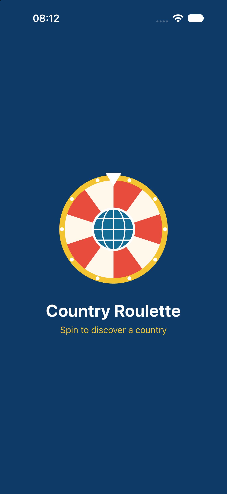
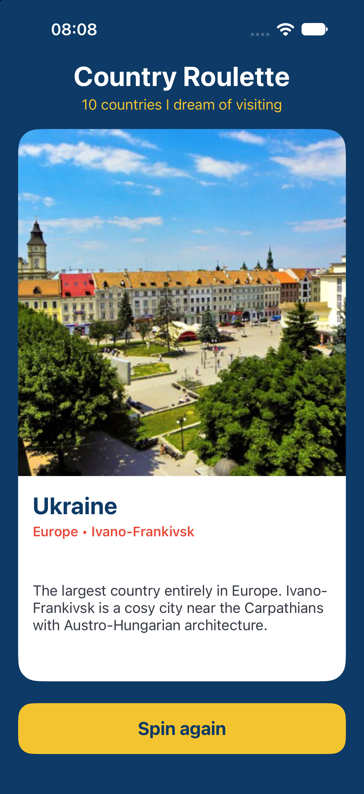
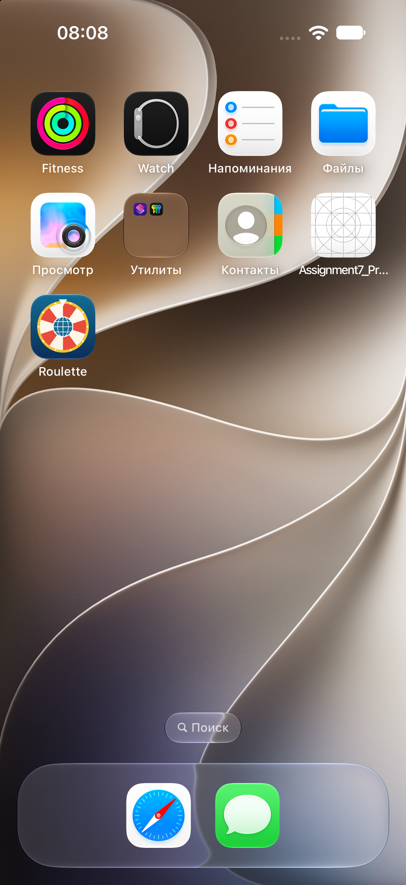

# Lab 6 · Favorites Roulette

**Author:** Iskander Bekishev
**Category:** Countries — 10 countries I dream of visiting.

## About the app

A single-screen app that shows a random favorite as a card. On launch the card shows an intro state (the roulette wheel and a hint). Each tap on **Spin** flips the card and shows a random country with its photo, title, region/city and a short description. The same country never appears twice in a row.

## Requirements checklist

| Requirement | Where |
|---|---|
| iOS App, Storyboard, Swift | `FavoritesRoulette.xcodeproj` |
| Display Name | `Roulette` (target → General → Display Name) |
| 10 favorites stored as an array of a struct | `Favorite.swift`, `Favorite+Data.swift` (`Favorite.all`) |
| Images in `Assets.xcassets` | 10 country image sets + `rouletteLogo` |
| Layout in `Main.storyboard` with `UIImageView`, `UILabel`, `UIButton` | `Base.lproj/Main.storyboard` |
| No Auto Layout | Auto Layout is turned off in both storyboards; views use autoresizing masks, no constraints |
| Initial state, not empty views | Intro card with the roulette logo and hint text |
| Images not stretched | Aspect Fit for the intro logo, Aspect Fill + Clip to Bounds for photos |
| No repeat twice in a row | `ViewController.spinTapped(_:)` picks from all indices except the current one |
| No force unwraps except `@IBOutlet` | Only `@IBOutlet ... !` declarations in the code |
| Custom launch screen, no constraints | `Base.lproj/LaunchScreen.storyboard` |
| Custom 1024×1024 App Icon, no transparency | `Assets.xcassets/AppIcon.appiconset` |

## Screenshots

| Launch screen | Main screen | Home Screen icon |
|---|---|---|
|  |  |  |

## How to run

Open `FavoritesRoulette.xcodeproj` in Xcode and run on any iPhone simulator.
