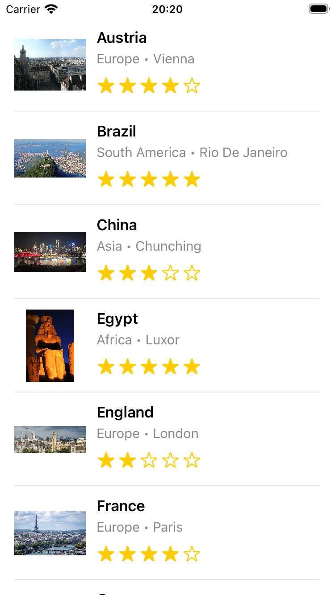
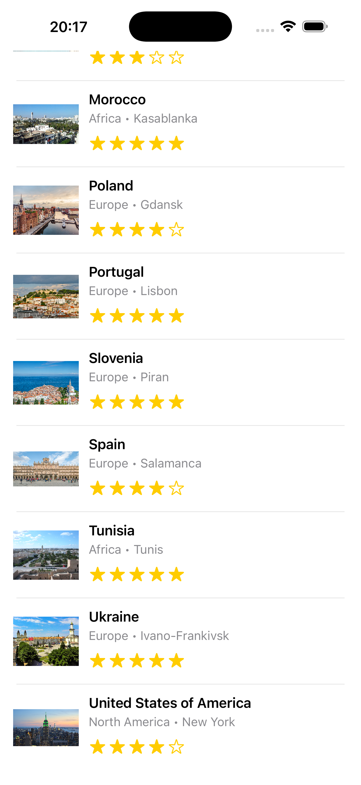

# Assignment #9 — Favorites List (UITableView & Custom Cells)

A UIKit app that shows a list of 20 favorite countries in a `UITableView` with a custom cell: photo, country name, continent and capital, and a 0–5 rating drawn with SF Symbols (`star.fill` / `star`).

## Theme

**Countries** — 20 items, each with its own image in `Assets.xcassets`.

## Project structure

| File | Purpose |
|---|---|
| `FavoriteItem.swift` | `struct FavoriteItem` — title, subtitle, image name, rating (0–5) |
| `FavoriteCell.swift` | `UITableViewCell` subclass: only `@IBOutlet`s and `configure(with:)`, no layout code |
| `ViewController.swift` | Holds the `[FavoriteItem]` array, implements `UITableViewDataSource`, dequeues cells with `dequeueReusableCell(withIdentifier:for:)` |
| `Main.storyboard` | Table view pinned to the Safe Area, prototype cell (class `FavoriteCell`, identifier `FavoriteCell`) with all Auto Layout |

## Layout

All constraints are set in `Main.storyboard` inside the prototype cell's content view:

- Image view on the left with a fixed 80 × 80 size.
- A vertical stack view (title, subtitle, rating) to the right of the image.
- The rating is a horizontal stack of 5 SF Symbol image views (Fill Equally).
- The title label has `Lines = 0`, so long titles wrap instead of overlapping the image or going off screen.
- Cell height follows its content (automatic row height).

## Screenshots

| iPhone SE (3rd gen) | iPhone 16 Pro Max |
|---|---|
|  |  |

## Screen recording

[Scrolling through the whole list](screenshots/demo.mov)

## How to run

Open `FavoritesList.xcodeproj` in Xcode and run on any iPhone simulator. No extra setup is needed.
